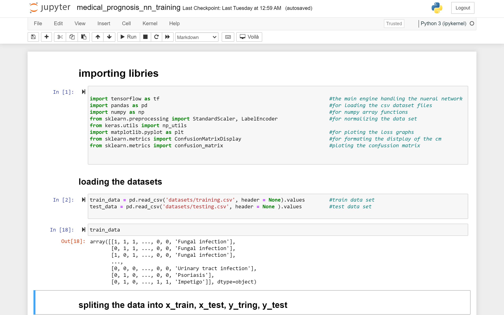

# Machine-Learning-Based Illness Diagnosis System

**B.Sc. Computer Science final-year project, Veritas University, Abuja (2022)**
*Design and Implementation of a Machine Learning Based Illness-Diagnosis System*
Supervisor: Dr. Felix Oshiorenoya Uloko

> **Not for medical use.** This is an academic project. It must not be used to diagnose, treat or advise anyone.

A web application that predicts one of 41 diseases from a patient's reported symptoms (132 binary symptom indicators), using a neural network trained in TensorFlow/Keras and served through Django.



---

## Repository layout

| Path | Contents |
|---|---|
| `neural_network/` | Training notebook (`medical_prognosis_nn_training.ipynb`) and exported model (`medical_prognosis.h5`) |
| `datasets/` | `training.csv`, `testing.csv` |
| `medic/` | Django 4.0 web application that loads the model and serves the diagnosis page |
| `outputs/` | Static CSV files used by the web app |
| `screenshots/` | UI screenshots |
| `revisit-2026/` | Re-evaluation added in 2026 (see below) |

## Original system (2022)

- **Data:** [Disease Prediction Using Machine Learning](https://www.kaggle.com/datasets/itachi9604/disease-prediction-using-machine-learning), hosted on Kaggle. 132 binary symptom columns and 1 disease label (41 classes).
- **Model:** input (132) → Dense 254, ReLU → Dense 41, softmax. Adam optimiser, categorical cross-entropy. 44,237 parameters.
- **Training:** 1 epoch with a 20% validation split.
- **Reported result:** 100% accuracy on the provided test file.
- **Web app:** the user selects symptoms, Django runs the model and shows the most likely disease.

## 2026 revisit: what the original evaluation got wrong

Looking back at this project in 2026, the 100% accuracy says more about the dataset than the model:

1. **Heavy duplication.** The training file has 4950 rows but only 304 unique symptom patterns. A model can memorise them.
2. **Tiny test set.** The test file has 41 rows, about one per disease, and those patterns also appear in the training data. That makes the test set easy and leaks training data into evaluation.
3. **One metric, one run.** Accuracy alone, from a single run with no comparison model, can't show whether the network adds anything.
4. **Code issues.** The label encoder was refit on the test labels (harmless here only because both files contain every class), and the reported test loss was identical to the validation loss, which suggests the evaluation call needed checking.

### Re-evaluation method

- Removed duplicate rows: 4920 → 304.
- Stratified 5-fold cross-validation on the de-duplicated data. One label encoder, fit once on all labels.
- Compared the neural network with simple baselines: multinomial Naive Bayes, decision tree, logistic regression.
- Reported macro precision, recall and F1 as well as accuracy, with mean ± standard deviation across folds.

### Results

| Model | Accuracy | Macro precision | Macro recall | Macro F1 |
|---|---|---|---|---|
| Neural network (original architecture) | 1.000 | 1.000 | 1.000 | 1.000 |
| Logistic regression | 1.000 | 1.000 | 1.000 | 1.000 |
| Decision tree | 0.621 | 0.546 | 0.559 | 0.526 |
| Naive Bayes | 0.977 | 0.964 | 0.971 | 0.966 |

The neural network and logistic regression both reached 100% across accuracy, precision, recall and macro F1. Multinomial Naive Bayes was also strong at 97.7% accuracy and a 96.6% macro F1, while the decision tree was much weaker at 62.1% accuracy and 52.6% macro F1. This suggests that a relatively simple linear model is more than competitive on this dataset, although the perfect scores are mainly explained by the repeated, highly distinctive symptom patterns rather than proven real-world medical ability. The decision-tree confusion matrix shows notably more cross-class mistakes; the neural network, logistic regression and Naive Bayes matrices are available alongside it in `revisit-2026/`.

### Limitations

- The data is small, likely synthetic, and uses yes/no symptoms with no severity, duration, age or test results. Real diagnosis needs much richer data.
- High scores on this dataset don't show the system would work on real patients.
- No clinical validation of any kind.

### What I learned

This revisit showed that a high accuracy score is only useful when the evaluation is independent and representative. Removing duplicate patterns and comparing several models gave a more credible picture than a single test run, and showed that a simple classifier can perform as well as the neural network here. If this project were rebuilt today, I would use patient-level and institution-level splits, keep a separate untouched test set, report confidence intervals and calibration, and collect real clinical data with demographic context and corroborating test results before considering it useful beyond an academic demonstration.

## Running it

```bash
# Re-evaluation
pip install -r requirements.txt
python revisit-2026/evaluate.py

# Web app
cd medic
python manage.py runserver
```

